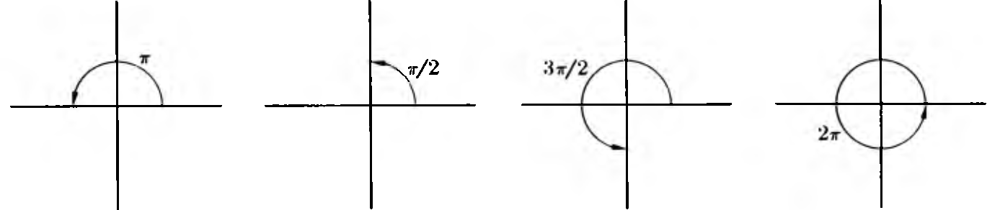

# 02 · Module 2 — Number Systems and Functions

> Source: Calculus Module 3. This module completes the course’s basic mathematics: functions, trigonometry, complex numbers, and analytic geometry.

## Functions

A function assigns exactly one output to every input in its domain. Write y = f(x); f(x) is the value at x. Functions on the same domain can be added or multiplied pointwise:

(f + g)(x) = f(x) + g(x), (fg)(x) = f(x)g(x).

A function is **even** if f(−x) = f(x), and **odd** if f(−x) = −f(x). For example, x² is even and x³ is odd.

## Trigonometry and radians

Radians measure angle by arc length: θ = s/r. On a unit circle, arc length s equals θ. Convert degrees to radians by multiplying by π/180; convert radians to degrees by multiplying by 180/π. Thus 180° = π radians and 90° = π/2.

For a right triangle, sin θ = opposite/hypotenuse and cos θ = adjacent/hypotenuse. Essential identities:

- sin²x + cos²x = 1
- sin(−x) = −sin x; cos(−x) = cos x
- sin(x + 2π) = sin x; cos(x + 2π) = cos x

## Complex numbers

A complex number is z = a + bi, where i² = −1. Add real and imaginary parts separately; multiply by expanding and replacing i² with −1. The conjugate of z = a + bi is z̄ = a − bi.

- z z̄ = a² + b²
- |z| = √(a² + b²), the distance from (a, b) to the origin

**Worked example:** (2 + 3i)(1 − i) = 2 − 2i + 3i − 3i² = 5 + i.

## Analytic geometry: straight lines

The line y = mx + b has slope m and vertical intercept b. From two distinct points:

m = (y₂ − y₁)/(x₂ − x₁), provided x₂ ≠ x₁.

Through (x₁, y₁) with slope m, use point-slope form y − y₁ = m(x − x₁).

**Worked example:** Through (1, 2) and (2, −1), m = (−1 − 2)/(2 − 1) = −3. Therefore y − 2 = −3(x − 1), or y = −3x + 5.

To find a line–circle intersection, substitute the line equation into x² + y² = r², solve the resulting quadratic, then recover y.

## Common errors

- A function cannot assign two different outputs to the same input.
- Degree and radian values are not interchangeable in calculus formulas; use radians.
- In complex multiplication, i² = −1, not 1.
- The slope formula fails for a vertical line (x₂ = x₁); such a line has equation x = constant.

## Active recall

1. Is f(x) = x² + 1 even or odd? Why?
2. Convert 150° to radians.
3. Find the conjugate and modulus of 3 − 4i.
4. Find the slope through (−1, 3) and (2, −6).

**Check:** even; 5π/6; 3 + 4i and 5; slope −3.
